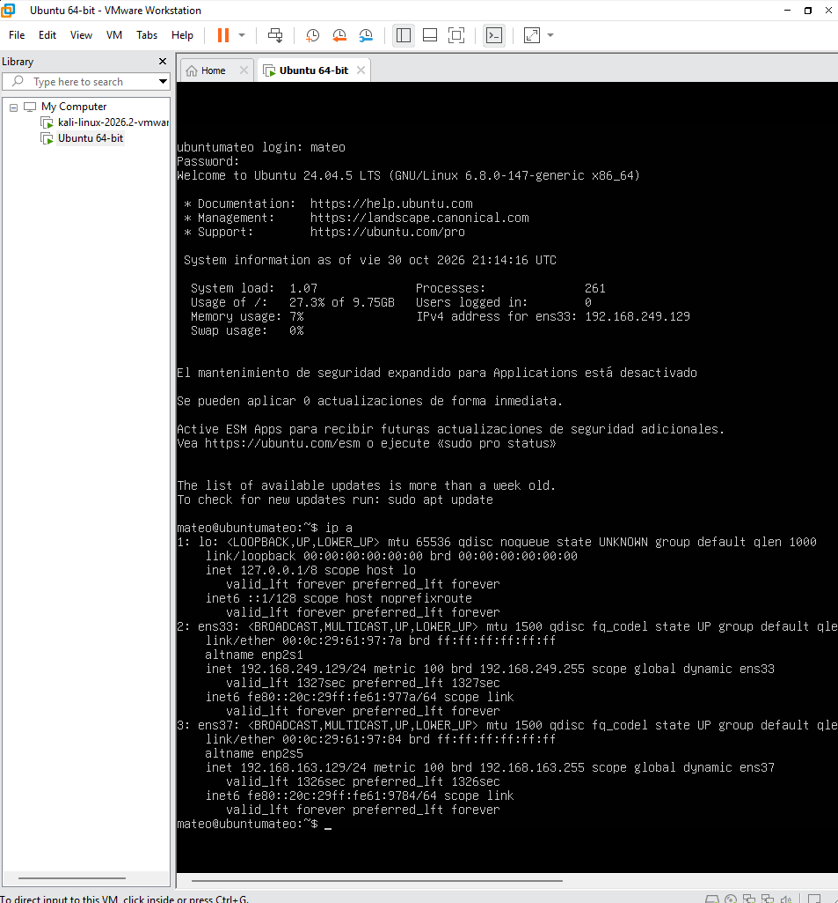
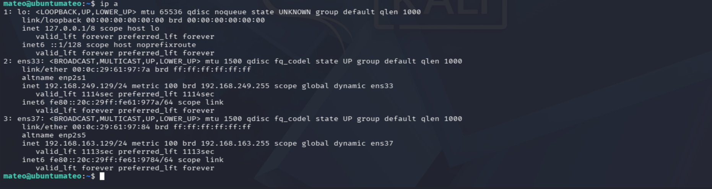
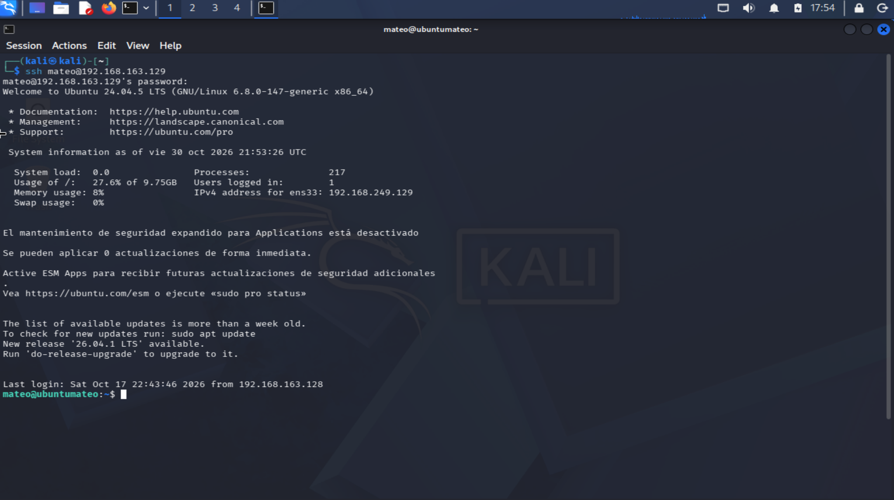
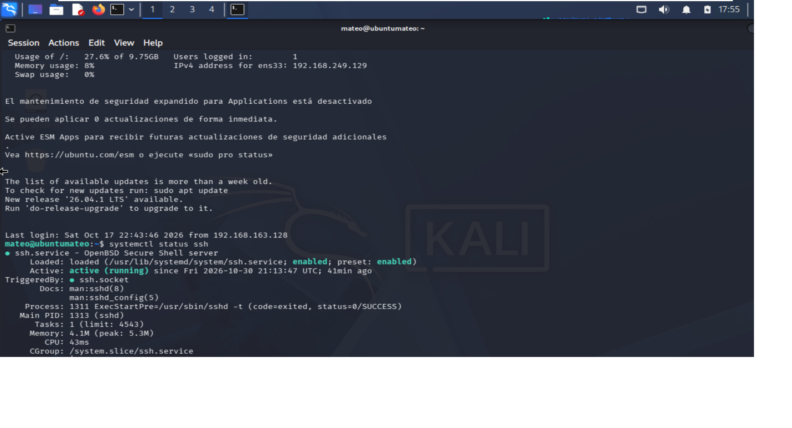
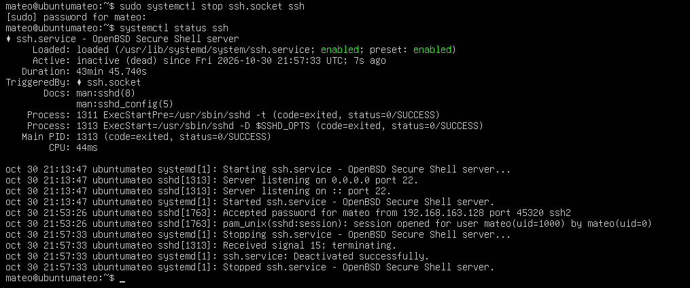
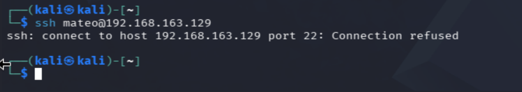
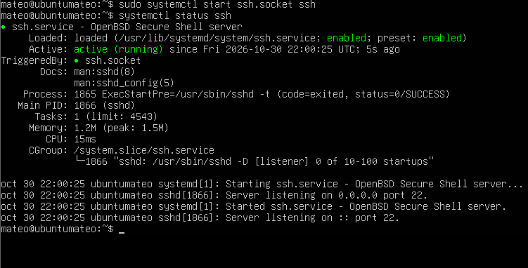
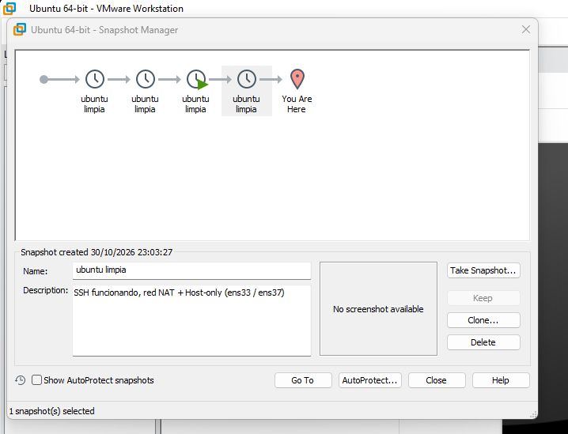

# Lab 0: SSH en Ubuntu Server y snapshot base

## Objetivo
Comprobar que el servicio SSH de la máquina víctima (Ubuntu Server) funciona, entender cómo se comporta cuando se para y dejar un snapshot limpio para volver a este estado en los siguientes labs.

## Entorno
- Host: portátil con VMware Workstation Pro 17.6.4
- Atacante: Kali Linux 2026.2 (NAT + Host-only)
- Víctima: Ubuntu Server 24.04 (NAT + Host-only)
- Red del lab: Host-only VMnet1, `192.168.163.0/24`
  - Ubuntu: `ens33` (NAT, `192.168.249.129`) y `ens37` (Host-only, `192.168.163.129`)



## Predicción 1
Antes de probar, anoté que Kali podría conectarse por SSH a Ubuntu sin instalar nada.

## Paso 1: comprobar la red
`ip a` en Ubuntu para identificar las interfaces.



## Paso 2: conexión SSH inicial desde Kali
```bash
ssh mateo@192.168.163.129
```
La conexión funcionó a la primera: SSH ya estaba instalado (el banner mostraba un último acceso anterior desde Kali).



**Resultado:** la predicción 1 fue correcta.

## Paso 3: comprobar el servicio
```bash
systemctl status ssh
```
Estado: `active (running)`.



## Predicción 2
Pensé que, aunque parase el servicio SSH, la conexión desde Kali seguiría funcionando.

## Paso 4: romper SSH a propósito
En la consola de Ubuntu:
```bash
sudo systemctl stop ssh.socket ssh
systemctl status ssh
```
Se paran `ssh.socket` y `ssh` porque en Ubuntu 24.04 el socket vuelve a arrancar el servicio al recibir una conexión.



Desde Kali:
```bash
ssh mateo@192.168.163.129
```
Resultado: `Connection refused`.



**Resultado:** la predicción 2 fue incorrecta. Al parar el servicio, la conexión deja de funcionar.

**Qué significa:** la máquina responde, pero no hay ningún proceso escuchando en el puerto 22. No es un problema de red, es que el servicio está parado.

## Paso 5: restaurar el servicio
```bash
sudo systemctl start ssh.socket ssh
```
La conexión vuelve a funcionar.



## Paso 6: snapshot
Con SSH activo, apagué la VM y creé el snapshot `Ubuntu limpia` en VMware (VM → Snapshot → Take Snapshot).



## Qué he aprendido
- Un `Connection refused` indica que el host está accesible pero el puerto está cerrado o el servicio parado.
- En Ubuntu 24.04 SSH funciona con activación por socket, así que hay que parar `ssh.socket` además de `ssh`.
- Un snapshot en estado limpio permite repetir los labs de ataque sin reinstalar.

## Siguiente paso
[Lab 1](../lab-01-nmap-descubrimiento/): descubrimiento de equipos con nmap.
