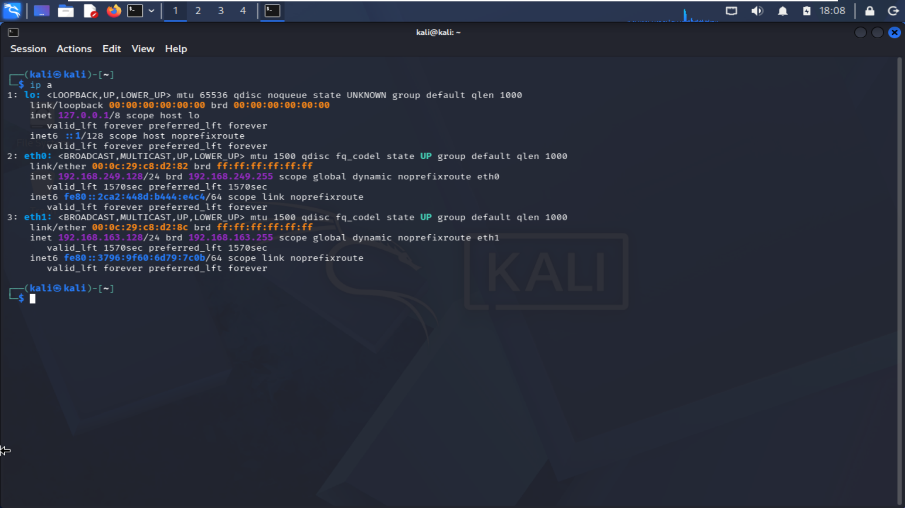
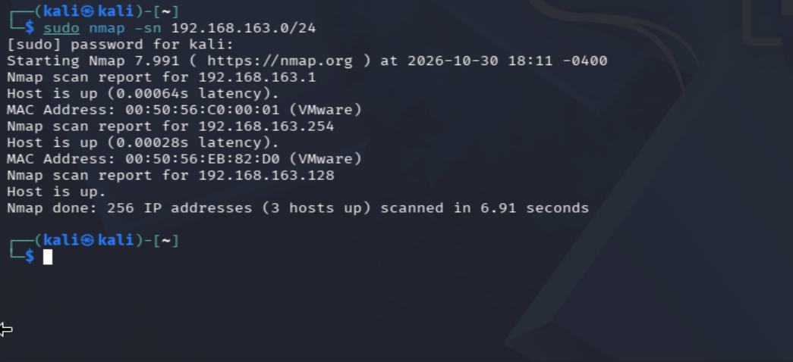
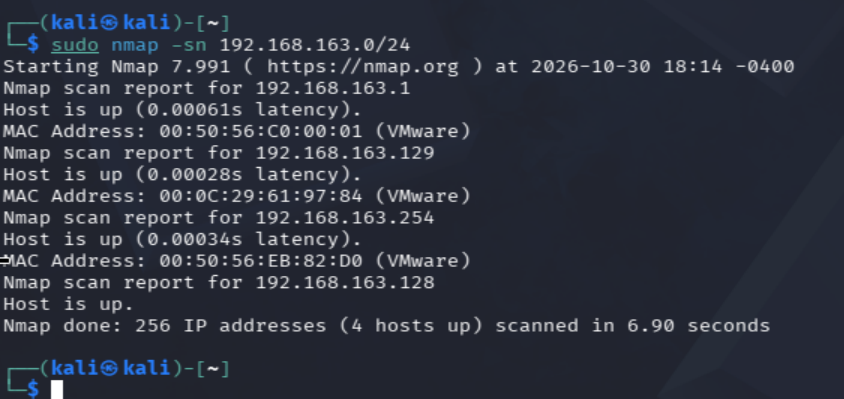

# Lab 1: nmap, descubrimiento de equipos

## Objetivo
Encontrar desde Kali qué equipos están activos en la red Host-only sin conocer sus IPs de antemano.

## Entorno
- Atacante: Kali Linux 2026.2
  - `eth0`: `192.168.249.128` (NAT)
  - `eth1`: `192.168.163.128` (Host-only, VMnet1)
- Víctima: Ubuntu Server 24.04 (`192.168.163.129` en Host-only)
- Red escaneada: Host-only VMnet1, `192.168.163.0/24`

## Predicción
Esperaba encontrar **2 equipos**: Kali (`.128`) y Ubuntu (`.129`).

## Paso 1: ver la IP de Kali
```bash
ip a
```
Kali tiene dos tarjetas: `eth0` en NAT y `eth1` en Host-only. Escaneo la red Host-only porque es la del lab, aislada de internet.



## Paso 2: primer escaneo de descubrimiento
```bash
sudo nmap -sn 192.168.163.0/24
```
- `-sn` desactiva el escaneo de puertos (antes se llamaba "ping scan", `-sP`): solo comprueba qué equipos responden.
- Con `sudo`, nmap usa ARP en la red local, que es más fiable que un ping.

Resultado: **3 hosts up** (`.1`, `.254` y `.128`). Ubuntu (`.129`) no apareció.



**Causa:** la VM de Ubuntu estaba apagada tras crear el snapshot. Un host apagado no responde, así que no sale en el escaneo.

## Paso 3: segundo escaneo con Ubuntu encendida
Encendí Ubuntu y repetí el escaneo.

Resultado: **4 hosts up**.

| IP | MAC | Qué es |
|---|---|---|
| `192.168.163.1` | `00:50:56:C0:00:01` | Mi portátil (adaptador Host-only de VMware) |
| `192.168.163.128` | (local) | Kali, la máquina desde la que escaneo |
| `192.168.163.129` | `00:0C:29:61:97:84` | Ubuntu Server (la víctima) |
| `192.168.163.254` | `00:50:56:EB:82:D0` | Servidor DHCP de VMware |



## Resultado
La predicción de 2 equipos **no fue correcta**: aparecieron 4. Kali y Ubuntu estaban, pero no conté el portátil (`.1`) ni el DHCP de VMware (`.254`), que también responden en la red.

## Qué he aprendido
- `nmap -sn` descubre todo lo que responde en la red, no solo las máquinas que yo creé.
- Un host que no aparece puede estar simplemente apagado. Antes de sacar conclusiones hay que comprobar que está encendido.
- El prefijo de la MAC ayuda a identificar equipos: `00:50:56` es la infraestructura de VMware (portátil y DHCP) y `00:0C:29` es una máquina virtual.
- nmap no muestra la MAC de Kali porque es la propia máquina que escanea: no necesita resolver su propia MAC por ARP.

## Siguiente paso
[Lab 2](../lab-02-nmap-puertos-servicios/): puertos y servicios con nmap.
