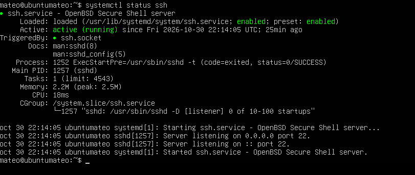
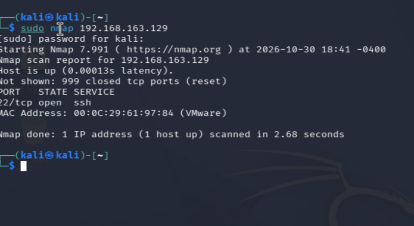
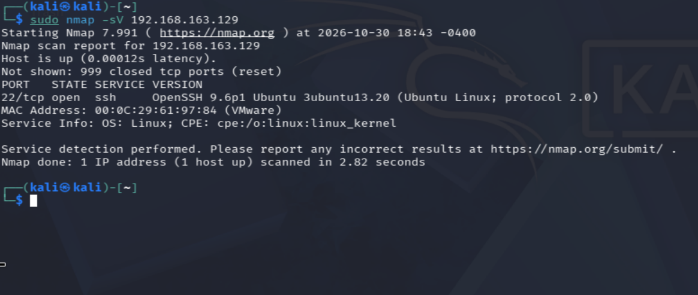
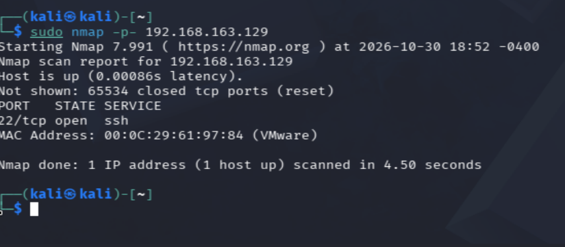
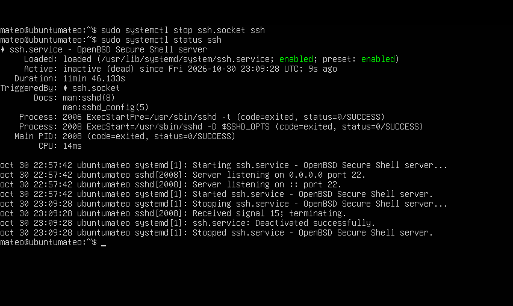
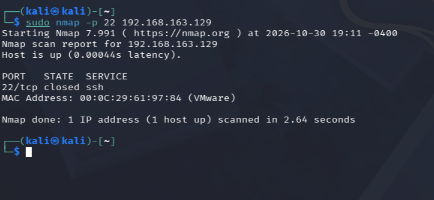
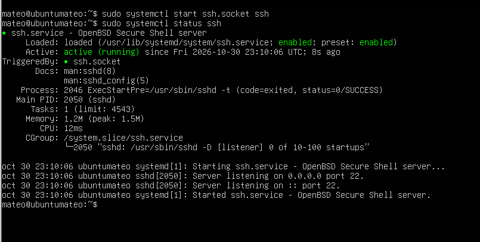

# Lab 2: nmap, puertos y servicios

## Objetivo
Descubrir qué puertos tiene abiertos la máquina víctima (Ubuntu Server) y qué programa y versión corre en cada uno, y entender la diferencia entre un puerto abierto, cerrado y filtrado.

## Entorno
- Atacante: Kali Linux 2026.2 (`192.168.163.128` en Host-only)
- Víctima: Ubuntu Server 24.04 (`192.168.163.129` en Host-only)
- Red: Host-only VMnet1, `192.168.163.0/24`

## Estado de partida
En Ubuntu, el servicio SSH está activo y escuchando en el puerto 22.



## Predicciones
1. Otros puertos abiertos además del 22: **ninguno**.
2. Programa y versión del puerto 22: **sin predicción**.
3. Estado de los puertos 80, 443 y 21: **closed**.

## Paso 1: escaneo básico
```bash
sudo nmap 192.168.163.129
```
Escanea los 1000 puertos más comunes.

Resultado: `22/tcp open ssh` y `Not shown: 999 closed tcp ports (reset)`.



- `closed (reset)`: el equipo responde activamente con un rechazo (RST). Hay respuesta, pero no hay ningún programa escuchando.
- `filtered` sería lo contrario: no hay respuesta, normalmente por un firewall que descarta los paquetes.
- La palabra `ssh` de la columna `SERVICE` es una deducción por el número de puerto, no está comprobada.

## Paso 2: servicio y versión
```bash
sudo nmap -sV 192.168.163.129
```
`-sV` conecta a cada puerto abierto y pregunta qué programa y versión es.

Resultado: `OpenSSH 9.6p1 Ubuntu 3ubuntu13.20 (Ubuntu Linux; protocol 2.0)`.



- `9.6p1` es la versión de OpenSSH y `3ubuntu13.20` es la compilación de Ubuntu, con sus parches.
- Ubuntu aplica parches de seguridad sin cambiar el número de versión de OpenSSH, así que el número solo no basta para saber si es vulnerable.
- El servidor revela su sistema operativo y su versión a cualquiera que lo escanee.

## Paso 3: todos los puertos
```bash
sudo nmap -p- 192.168.163.129
```
`-p-` escanea los 65535 puertos, no solo los 1000 más comunes.

Resultado: `Not shown: 65534 closed tcp ports (reset)` y solo el 22 abierto, en 4,5 segundos.



Es tan rápido porque es una red virtual sin latencia y cada puerto cerrado responde al instante. En una red real con firewall, el mismo escaneo puede tardar mucho más.

## Paso 4: un puerto cerrado de verdad
Predicción: con SSH parado, el puerto 22 saldrá `closed`.

En Ubuntu:
```bash
sudo systemctl stop ssh.socket ssh
sudo systemctl status ssh
```
El servicio queda `inactive (dead)`.



En Kali:
```bash
sudo nmap -p 22 192.168.163.129
```
Resultado: el puerto 22 sale `closed`.



Sale `closed` y no `filtered` porque Ubuntu sigue encendida y contesta con un rechazo. No hay firewall en medio.

## Paso 5: restaurar SSH
En Ubuntu:
```bash
sudo systemctl start ssh.socket ssh
systemctl status ssh
```
Vuelve a salir `active (running)`.



## Resultado
Las predicciones 1 y 3 y la de cierre del puerto fueron correctas. Ubuntu expone un único servicio, OpenSSH, en el puerto 22.

## Qué he aprendido
- `nmap` sin opciones solo mira los 1000 puertos más comunes. `-p-` mira todos.
- Un puerto `closed` responde con un rechazo. Uno `filtered` no responde.
- `-sV` comprueba de verdad el programa y la versión, en vez de deducirlos por el número de puerto.
- La versión exacta es lo primero que se busca en un reconocimiento para ver si hay vulnerabilidades conocidas, pero con los parches de Ubuntu hay que mirar también el sufijo de compilación.

## Siguiente paso
Lab 3: Wireshark básico.
