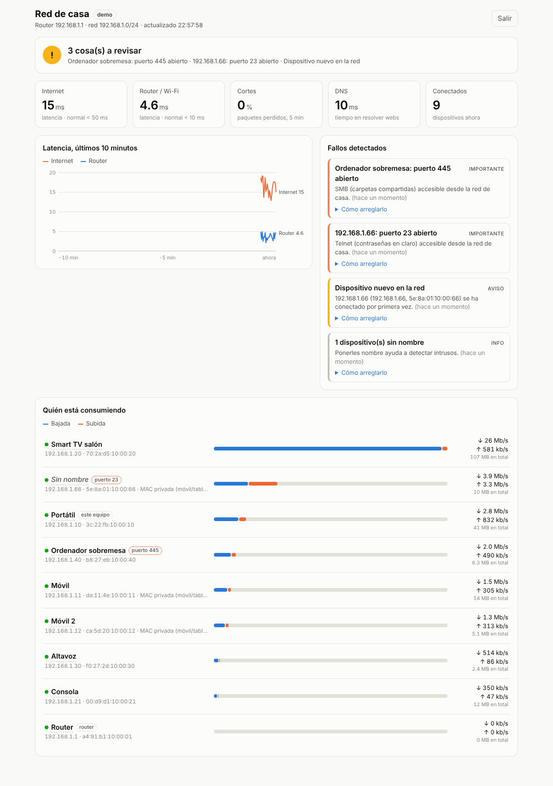

# Monitor de la red de casa

App web para la gente de casa: ver en tiempo real cómo va la red, qué fallos hay (con cómo arreglarlos) y qué dispositivos consumen más.



## Qué hace

| Parte | Cómo lo mide | Cada cuánto |
|---|---|---|
| Latencia a internet y al router | `ping` a `1.1.1.1` (o `8.8.8.8`) y al router | 5 s |
| DNS | Tiempo en resolver `www.google.com` | 5 s |
| Cortes | % de pings a internet sin respuesta en 5 min | 5 s |
| Dispositivos conectados | Barrido de ping de la subred + tabla ARP | 60 s |
| Puertos peligrosos | Conexión TCP a 21, 23, 139, 445, 3389, 5900 en cada dispositivo | 10 min |
| Consumo por dispositivo | Captura de paquetes con `scapy` (opcional, ver abajo) | continuo |

**Fallos que detecta:** router caído, sin internet, DNS caído, conexión inestable, internet lento, Wi-Fi saturado, dispositivo nuevo desconocido y puertos peligrosos abiertos. Cada uno trae un "Cómo arreglarlo".

**Solo para la gente de casa:**
- Rechaza cualquier conexión que no venga de una IP privada (de la red local).
- Pide una contraseña común para la familia. La sesión dura 30 días.
- Frena los intentos de contraseña a lo bruto (1 s tras cada fallo, 60 s tras 5 fallos).
- **No abras el puerto en el router.** La app está pensada para no salir de casa.

## Probarla sin tocar nada (modo demo)

```bash
cd monitor-red-casa
MONITOR_CLAVE=prueba python3 app.py --demo
```

Abre <http://localhost:8080> y entra con `prueba`. A los 30 s aparece un "intruso" con Telnet abierto. Cada 3 minutos el Wi-Fi simulado se satura 40 s, para que veas los avisos.

## Instalarla en casa

Necesita un equipo que esté siempre encendido y conectado a la red de casa. Lo ideal es una Raspberry Pi; un PC también sirve. Solo hace falta Python 3.9 o superior, sin librerías extra.

```bash
git clone https://github.com/mateoaaay/cyber-lab.git
cd cyber-lab/monitor-red-casa
sudo python3 app.py
```

La primera vez imprime la **contraseña de la familia** (queda guardada en `datos/clave.txt`) y la dirección a abrir, p. ej. `http://192.168.1.50:8080`. Ábrela desde los móviles de casa y añádela a la pantalla de inicio.

Opciones de `config.json` (copia `config.ejemplo.json`). Todas son opcionales:

| Campo | Para qué |
|---|---|
| `clave` | Elegir tú la contraseña (también vale la variable `MONITOR_CLAVE`) |
| `router` | IP del router, si no la detecta solo |
| `subred` | Subred a vigilar, p. ej. `192.168.1.0/24` (por defecto, la /24 del equipo) |
| `interfaz` | Interfaz donde capturar tráfico, p. ej. `eth0` o `wlan0` |

Pon nombre a cada dispositivo tocándolo en la lista ("Móvil de Ana", "Tele del salón"…). Así, si aparece uno que nadie reconoce, salta el aviso de **dispositivo nuevo**.

### Arrancarla sola al encender (Raspberry Pi / Linux)

`/etc/systemd/system/monitor-casa.service`:

```ini
[Unit]
Description=Monitor de la red de casa
After=network-online.target
Wants=network-online.target

[Service]
WorkingDirectory=/home/pi/cyber-lab/monitor-red-casa
ExecStart=/usr/bin/python3 app.py
Restart=always

[Install]
WantedBy=multi-user.target
```

```bash
sudo systemctl enable --now monitor-casa
```

## Consumo por dispositivo

Este es el punto delicado, y conviene entenderlo. En una red de casa, el tráfico del móvil de tu hermano va del móvil al router. **No pasa por el equipo donde corre la app**, así que no se puede medir desde ahí. Hay tres formas de conseguirlo:

1. **El equipo está "en medio"** (lo más fiable). Por ejemplo, una Raspberry Pi hace de punto de acceso Wi-Fi o de router, o el equipo va conectado a un switch gestionable con *port mirroring* del puerto del router. Entonces:
   ```bash
   sudo pip install scapy
   sudo python3 app.py
   ```
2. **Usar las estadísticas del router.** Muchos routers (OpenWrt, ASUS, UniFi, Fritz!Box…) ya cuentan el consumo por dispositivo. Se puede añadir una fuente que lea de ahí: dime qué router tienes y la preparo.
3. **Sin nada de lo anterior:** la app sigue funcionando. Con `scapy` instalado solo verá el consumo del propio equipo. Sin `scapy`, la sección de consumo muestra un aviso y lo demás (fallos, dispositivos, latencia) va igual.

Capturar paquetes necesita permisos de administrador; por eso se ejecuta con `sudo`.

## Archivos

| Archivo | Qué hay |
|---|---|
| `app.py` | Arranque y opciones |
| `monitor.py` | Mediciones periódicas, historial y reglas de fallos |
| `red.py` | Ping, router, DNS, ARP y puertos (Linux, macOS y Windows) |
| `trafico.py` | Contador de consumo con `scapy` |
| `servidor.py` | Servidor web, contraseña y filtro de IPs de casa |
| `demo.py` | Red simulada para `--demo` |
| `static/` | La web (HTML, CSS y JS, sin dependencias externas) |
| `datos/` | Contraseña, secreto de sesión y nombres de dispositivos (no se sube a git) |

## Tests

```bash
python3 -m unittest discover -s tests -v
```

## Limitaciones

- La web va por HTTP dentro de casa, sin HTTPS. Basta para una red doméstica de confianza; no la expongas a internet.
- Los móviles con **MAC privada** pueden cambiarla y aparecer como "nuevos". En el móvil, desactiva la MAC privada solo para el Wi-Fi de casa.
- El historial vive en memoria: al reiniciar la app se pierde la última hora de gráfica. Los nombres sí se guardan.
